# Визуальные диаграммы для шаблонов проектов
*Уровень абстракции: α=-2 (документация)*
*Статус: ↔ ГОРИЗОНТАЛЬНО (визуализация методологии)*
*Дата создания: 2026-01-24*

---

## 📊 О документе

Этот документ содержит готовые визуальные диаграммы для всех 16 типов проектов. Диаграммы созданы с использованием Mermaid и могут быть встроены в любую документацию проекта.

**Все диаграммы:**
- ✅ Совместимы с GitHub Markdown
- ✅ Отображаются в современных IDE (VS Code, IntelliJ)
- ✅ Могут быть экспортированы в PNG/SVG
- ✅ Интегрированы с методологией ⇑⇓↔

---

## 🎯 Как использовать

### В Markdown файлах
```markdown
```mermaid
[копируйте диаграмму сюда]
` ``
```

### В GitHub
Диаграммы автоматически рендерятся в README.md, Issues, Pull Requests.

### Экспорт
Используйте Mermaid CLI или онлайн-редактор:
- https://mermaid.live/
- `npm install -g @mermaid-js/mermaid-cli`

---

## 💻 1. Software Project Diagrams

### 1.1 Архитектура микросервисов

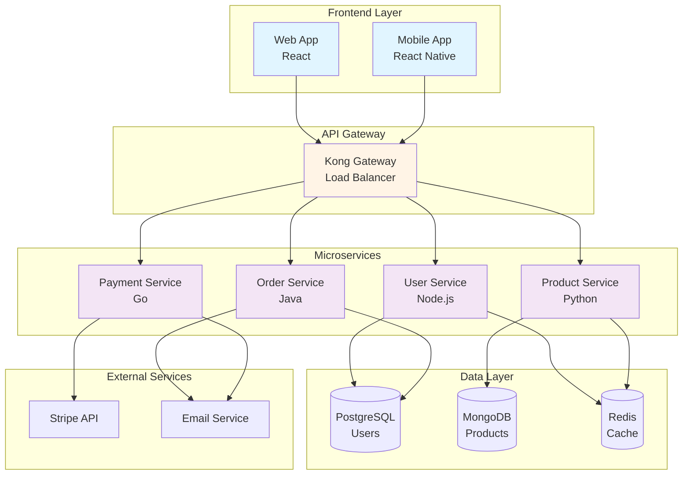

### 1.2 CI/CD Pipeline

```mermaid
graph LR
    subgraph "Development"
        CODE[Code Push]
        PR[Pull Request]
    end

    subgraph "CI Pipeline"
        LINT[Linting]
        TEST[Unit Tests]
        BUILD[Build]
        SCAN[Security Scan]
    end

    subgraph "CD Pipeline"
        STAGE[Deploy Staging]
        E2E[E2E Tests]
        PROD[Deploy Production]
    end

    subgraph "Monitoring"
        MONITOR[Monitoring]
        ALERT[Alerts]
    end

    CODE --> PR
    PR --> LINT
    LINT --> TEST
    TEST --> BUILD
    BUILD --> SCAN
    SCAN --> STAGE
    STAGE --> E2E
    E2E --> PROD
    PROD --> MONITOR
    MONITOR --> ALERT

    style CODE fill:#e8f5e9
    style LINT fill:#fff9c4
    style TEST fill:#fff9c4
    style BUILD fill:#fff9c4
    style SCAN fill:#ffccbc
    style STAGE fill:#e1f5ff
    style PROD fill:#c8e6c9
```

### 1.3 Методология ⇑⇓↔ в Software проекте

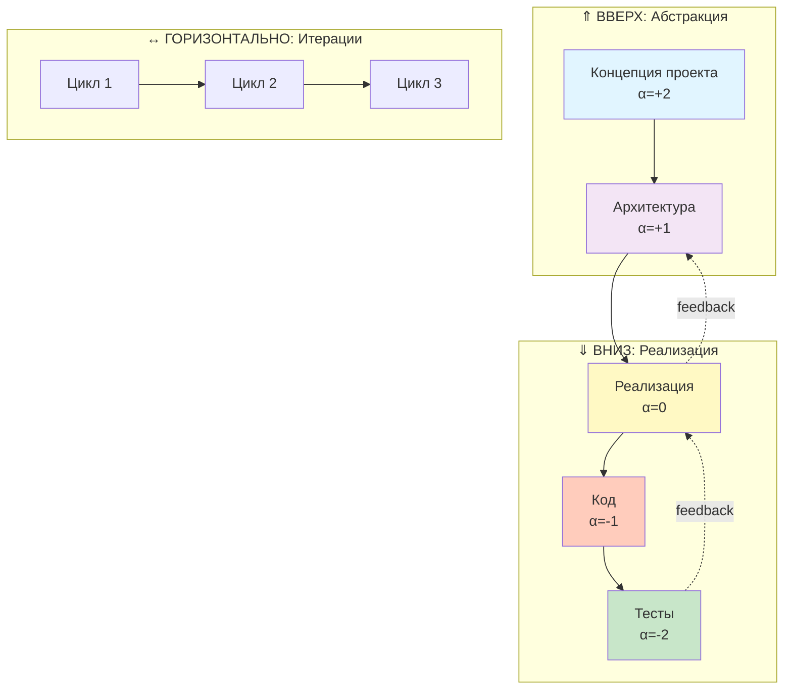

---

## 🏥 2. Healthcare Project Diagrams

### 2.1 Клинический протокол: Телемедицина

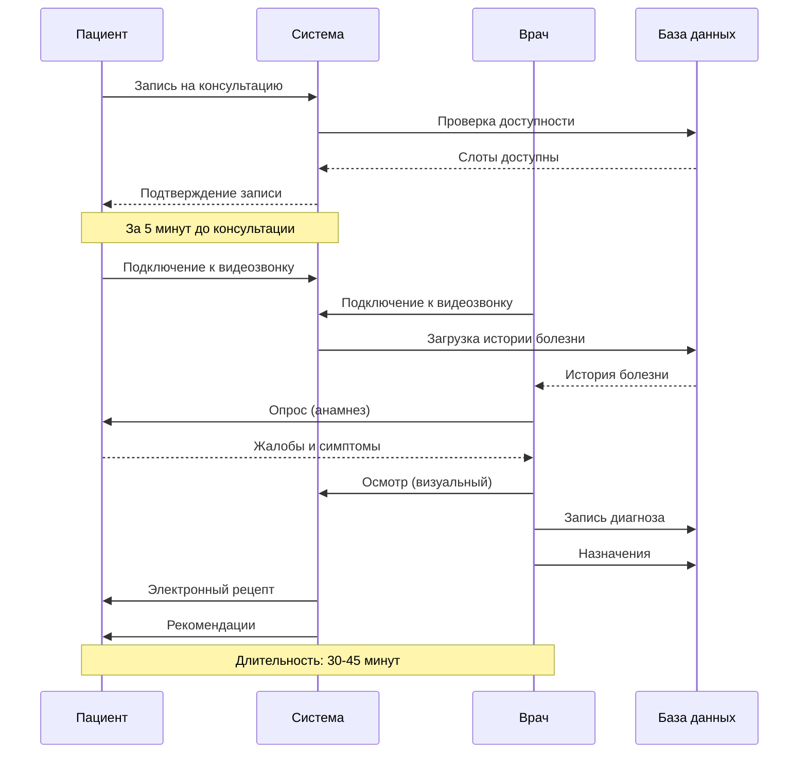

### 2.2 Путь пациента (Patient Journey)

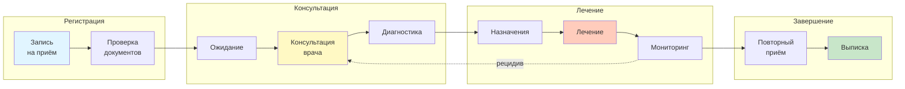

### 2.3 Система управления медицинскими данными

```mermaid
graph TB
    subgraph "Источники данных"
        EMR[Электронная<br/>медкарта]
        LAB[Лабораторные<br/>результаты]
        IMAGING[Медицинская<br/>визуализация]
    end

    subgraph "Обработка"
        VALIDATE[Валидация<br/>данных]
        ENCRYPT[Шифрование<br/>HIPAA]
        STORE[Хранилище]
    end

    subgraph "Доступ"
        DOCTOR[Врач]
        PATIENT[Пациент]
        RESEARCH[Исследования<br/>(анонимные)]
    end

    EMR --> VALIDATE
    LAB --> VALIDATE
    IMAGING --> VALIDATE

    VALIDATE --> ENCRYPT
    ENCRYPT --> STORE

    STORE --> DOCTOR
    STORE --> PATIENT
    STORE --> RESEARCH

    style ENCRYPT fill:#ffccbc
    style STORE fill:#e1f5ff
```

---

## 🏭 3. Manufacturing Project Diagrams

### 3.1 Производственный процесс

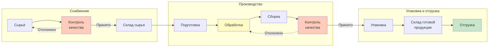

### 3.2 Управление производством (Kanban)

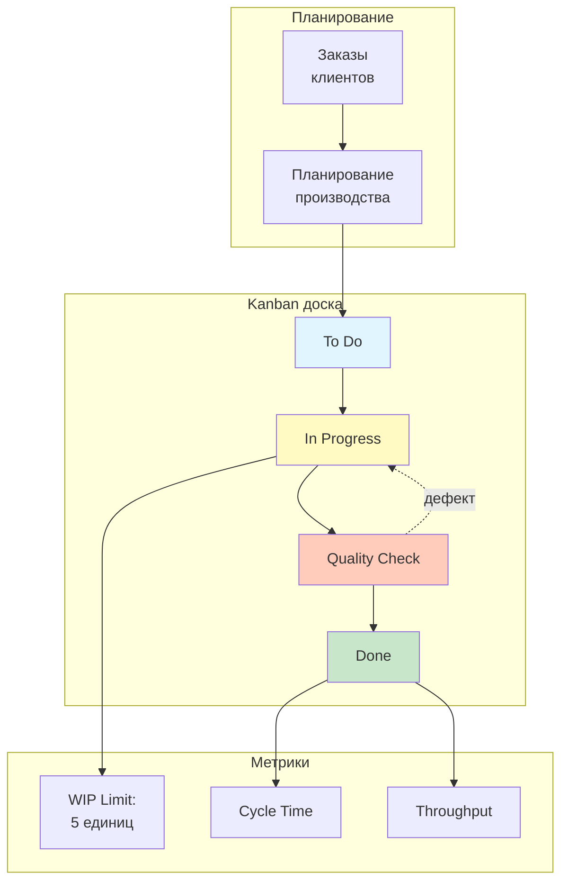

---

## 💰 4. Finance Project Diagrams

### 4.1 Процесс инвестирования

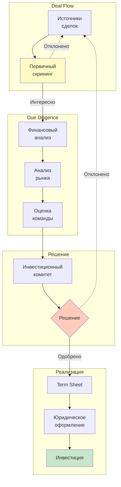

### 4.2 Управление портфелем

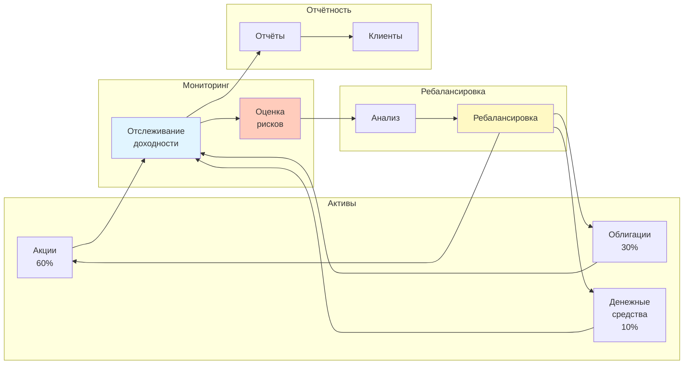

---

## 📚 5. Education Project Diagrams

### 5.1 Разработка курса

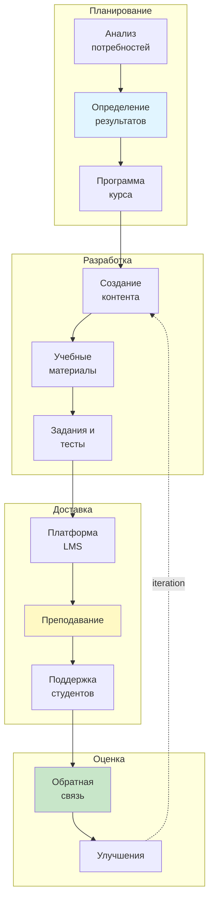

### 5.2 Путь студента

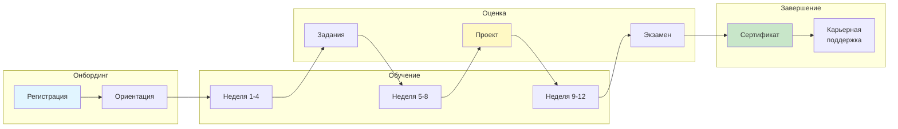

---

## 🔬 6. Research Project Diagrams

### 6.1 Научный метод

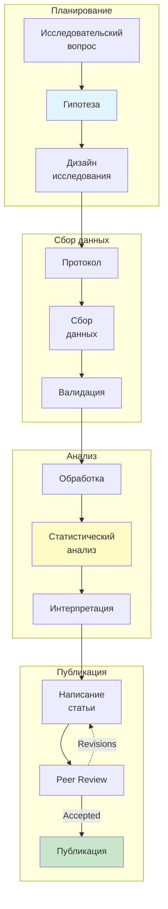

---

## 🌾 7. Agriculture Project Diagrams

### 7.1 Севооборот (4 поля)

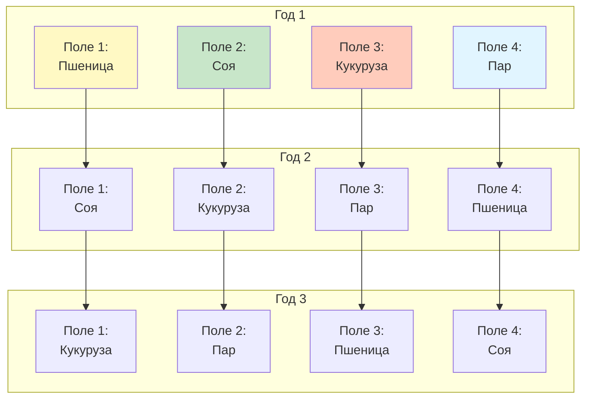

### 7.2 Процесс производства

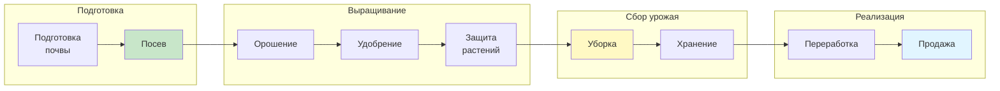

---

## ⚖️ 8. Legal Project Diagrams

### 8.1 Судебный процесс

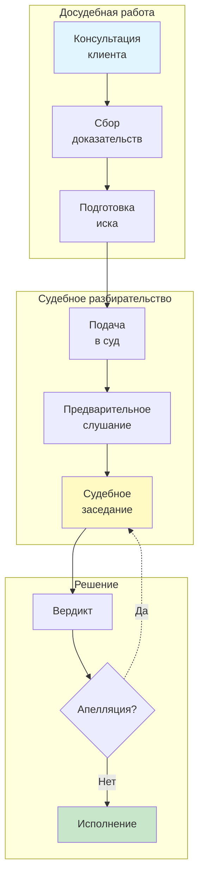

---

## 🎨 9. Arts Project Diagrams

### 9.1 Создание выставки

```mermaid
graph LR
    subgraph "Концепция"
        IDEA[Идея]
        THEME[Тема]
        CURATOR[Кураторство]
    end

    subgraph "Подготовка"
        ARTISTS[Выбор<br/>художников]
        WORKS[Сбор<br/>произведений]
        SPACE[Подготовка<br/>пространства]
    end

    subgraph "Реализация"
        INSTALL[Инсталляция]
        OPENING[Открытие]
        EXHIBIT[Выставка]
    end

    subgraph "Завершение"
        CLOSE[Закрытие]
        ARCHIVE[Архивация]
    end

    IDEA --> THEME
    THEME --> CURATOR
    CURATOR --> ARTISTS
    ARTISTS --> WORKS
    WORKS --> SPACE
    SPACE --> INSTALL
    INSTALL --> OPENING
    OPENING --> EXHIBIT
    EXHIBIT --> CLOSE
    CLOSE --> ARCHIVE

    style IDEA fill:#e1f5ff
    style OPENING fill:#fff9c4
    style ARCHIVE fill:#c8e6c9
```

---

## 🏢 10. Business Project Diagrams

### 10.1 Запуск стартапа

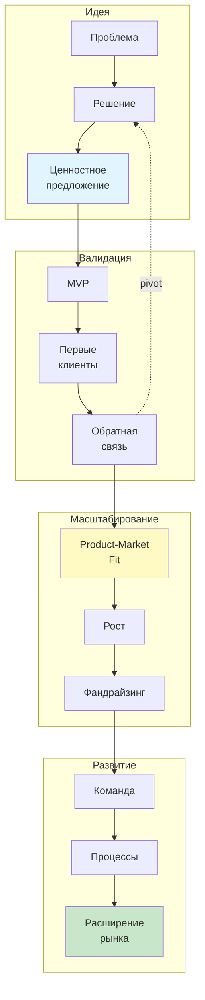

---

## 🏛️ 11. Government Project Diagrams

### 11.1 Разработка политики

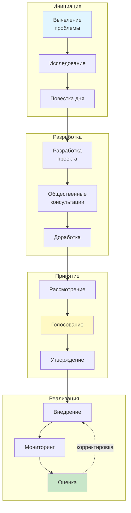

---

## 🤝 12. Nonprofit Project Diagrams

### 12.1 Программа помощи

```mermaid
graph LR
    subgraph "Планирование"
        MISSION[Миссия]
        NEEDS[Оценка<br/>потребностей]
        PROGRAM[Программа]
    end

    subgraph "Фандрайзинг"
        DONORS[Поиск<br/>доноров]
        GRANTS[Гранты]
        CAMPAIGN[Кампания]
    end

    subgraph "Реализация"
        DELIVER[Предоставление<br/>услуг]
        BENEFIC[Бенефициары]
        TRACK[Отслеживание]
    end

    subgraph "Отчётность"
        IMPACT[Оценка<br/>влияния]
        REPORT[Отчёты]
        DONORS2[Донорам]
    end

    MISSION --> NEEDS
    NEEDS --> PROGRAM
    PROGRAM --> DONORS
    DONORS --> GRANTS
    GRANTS --> CAMPAIGN
    CAMPAIGN --> DELIVER
    DELIVER --> BENEFIC
    BENEFIC --> TRACK
    TRACK --> IMPACT
    IMPACT --> REPORT
    REPORT --> DONORS2

    style MISSION fill:#e1f5ff
    style DELIVER fill:#fff9c4
    style IMPACT fill:#c8e6c9
```

---

## ⚽ 13. Sports Project Diagrams

### 13.1 Программа тренировок

```mermaid
graph TB
    subgraph "Оценка"
        ASSESS[Первичная<br/>оценка]
        GOALS[Цели]
    end

    subgraph "Планирование"
        PERIOD[Периодизация]
        MACRO[Макроцикл]
        MESO[Мезоцикл]
        MICRO[Микроцикл]
    end

    subgraph "Тренировки"
        TECHNICAL[Технические<br/>навыки]
        TACTICAL[Тактика]
        PHYSICAL[Физическая<br/>подготовка]
        MENTAL[Психологическая<br/>подготовка]
    end

    subgraph "Мониторинг"
        GPS[GPS tracking]
        PERFORMANCE[Показатели]
        ADJUST[Корректировка]
    end

    ASSESS --> GOALS
    GOALS --> PERIOD
    PERIOD --> MACRO
    MACRO --> MESO
    MESO --> MICRO

    MICRO --> TECHNICAL
    MICRO --> TACTICAL
    MICRO --> PHYSICAL
    MICRO --> MENTAL

    TECHNICAL --> GPS
    TACTICAL --> GPS
    PHYSICAL --> GPS

    GPS --> PERFORMANCE
    PERFORMANCE --> ADJUST
    ADJUST -.feedback.-> MICRO

    style GOALS fill:#e1f5ff
    style PHYSICAL fill:#fff9c4
    style ADJUST fill:#c8e6c9
```

---

## 🏨 14. Hospitality Project Diagrams

### 14.1 Гостевой цикл (Guest Cycle)

```mermaid
graph LR
    subgraph "Pre-arrival"
        RESERVE[Бронирование]
        CONFIRM[Подтверждение]
        PREP[Подготовка<br/>номера]
    end

    subgraph "Arrival"
        CHECKIN[Регистрация]
        WELCOME[Приветствие]
        ROOM[Размещение]
    end

    subgraph "Occupancy"
        SERVICE[Обслуживание]
        AMENITIES[Удобства]
        REQUESTS[Запросы]
    end

    subgraph "Departure"
        CHECKOUT[Выезд]
        PAYMENT[Оплата]
        FEEDBACK[Отзыв]
    end

    RESERVE --> CONFIRM
    CONFIRM --> PREP
    PREP --> CHECKIN
    CHECKIN --> WELCOME
    WELCOME --> ROOM
    ROOM --> SERVICE
    SERVICE --> AMENITIES
    AMENITIES --> REQUESTS
    REQUESTS --> CHECKOUT
    CHECKOUT --> PAYMENT
    PAYMENT --> FEEDBACK

    style WELCOME fill:#e1f5ff
    style SERVICE fill:#fff9c4
    style FEEDBACK fill:#c8e6c9
```

---

## 🛒 15. Retail Project Diagrams

### 15.1 Цепочка поставок

```mermaid
graph LR
    subgraph "Снабжение"
        SUPPLIER[Поставщики]
        ORDER[Заказ]
        RECEIVE[Приёмка]
    end

    subgraph "Складирование"
        STORAGE[Хранение]
        INVENTORY[Инвентаризация]
    end

    subgraph "Продажа"
        DISPLAY[Выкладка]
        SALE[Продажа]
        POS[Касса]
    end

    subgraph "Аналитика"
        TRACK[Отслеживание]
        FORECAST[Прогноз]
        REORDER[Дозаказ]
    end

    SUPPLIER --> ORDER
    ORDER --> RECEIVE
    RECEIVE --> STORAGE
    STORAGE --> INVENTORY
    INVENTORY --> DISPLAY
    DISPLAY --> SALE
    SALE --> POS
    POS --> TRACK
    TRACK --> FORECAST
    FORECAST --> REORDER
    REORDER --> SUPPLIER

    style ORDER fill:#e1f5ff
    style SALE fill:#fff9c4
    style FORECAST fill:#c8e6c9
```

---

## 🎯 16. Hobby Project Diagrams

### 16.1 Разработка хобби-проекта

```mermaid
graph TB
    subgraph "Идея"
        INTEREST[Интерес]
        EXPLORE[Исследование]
        DECIDE[Решение]
    end

    subgraph "Подготовка"
        LEARN[Обучение]
        TOOLS[Инструменты]
        PLAN[План]
    end

    subgraph "Создание"
        PROTOTYPE[Прототип]
        ITERATE[Итерации]
        IMPROVE[Улучшение]
    end

    subgraph "Sharing"
        DOCUMENT[Документация]
        SHARE[Публикация]
        COMMUNITY[Сообщество]
    end

    INTEREST --> EXPLORE
    EXPLORE --> DECIDE
    DECIDE --> LEARN
    LEARN --> TOOLS
    TOOLS --> PLAN
    PLAN --> PROTOTYPE
    PROTOTYPE --> ITERATE
    ITERATE --> IMPROVE
    IMPROVE --> DOCUMENT
    DOCUMENT --> SHARE
    SHARE --> COMMUNITY

    COMMUNITY -.inspiration.-> EXPLORE

    style INTEREST fill:#e1f5ff
    style ITERATE fill:#fff9c4
    style COMMUNITY fill:#c8e6c9
```

---

## 🔄 Универсальная диаграмма методологии ⇑⇓↔

### Применимо ко ВСЕМ 16 типам проектов

```mermaid
graph TB
    subgraph "⇑ Восходящее движение (Абстракция)"
        direction TB
        A3[α=+3: Философия]
        A2[α=+2: Концепция]
        A1[α=+1: Стратегия]
    end

    subgraph "↔ Горизонтальное движение (Итерации)"
        direction LR
        C1[Цикл 1]
        C2[Цикл 2]
        C3[Цикл 3]
        Cn[Цикл N]
    end

    subgraph "⇓ Нисходящее движение (Реализация)"
        direction TB
        A0[α=0: Архитектура]
        AN1[α=-1: Реализация]
        AN2[α=-2: Детали]
        AN3[α=-3: Документация]
    end

    A3 --> A2
    A2 --> A1
    A1 --> A0
    A0 --> AN1
    AN1 --> AN2
    AN2 --> AN3

    AN3 -.обратная связь.-> A1
    AN2 -.обратная связь.-> A0

    C1 --> C2
    C2 --> C3
    C3 --> Cn

    style A3 fill:#e3f2fd
    style A2 fill:#bbdefb
    style A1 fill:#90caf9
    style A0 fill:#fff9c4
    style AN1 fill:#ffccbc
    style AN2 fill:#ffab91
    style AN3 fill:#ff8a65
```

---

## 📊 Диаграмма метрик здоровья проекта

### CD, VT, CR, DB для любого типа проекта

```mermaid
graph TB
    subgraph "Метрики"
        CD[Connection Density<br/>CD = 10-20%]
        VT[Vertical Traceability<br/>VT = 40-60%]
        CR[Cycle Rate<br/>CR = 0.8-1.2]
        DB[Direction Balance<br/>DB = 80-120%]
    end

    subgraph "Источники данных"
        DOCS[Документы]
        LINKS[Связи]
        CYCLES[Циклы]
    end

    subgraph "Здоровье проекта"
        HEALTH{Оценка}
        GREEN[✅ Здоровый]
        YELLOW[⚠️ Требует<br/>внимания]
        RED[🔴 Проблемы]
    end

    DOCS --> CD
    LINKS --> CD
    DOCS --> VT
    LINKS --> VT
    CYCLES --> CR
    DOCS --> DB

    CD --> HEALTH
    VT --> HEALTH
    CR --> HEALTH
    DB --> HEALTH

    HEALTH -->|Все в норме| GREEN
    HEALTH -->|Отклонения| YELLOW
    HEALTH -->|Критично| RED

    style GREEN fill:#c8e6c9
    style YELLOW fill:#fff9c4
    style RED fill:#ffccbc
```

---

## 🎨 Легенда цветов

Все диаграммы используют единую цветовую схему:

- 🔵 **Синий (#e1f5ff)**: Начальные/входные этапы
- 💜 **Фиолетовый (#f3e5f5)**: Сервисы/компоненты
- 💛 **Жёлтый (#fff9c4)**: Процессы/обработка
- 🧡 **Оранжевый (#ffccbc)**: Критичные/проверочные этапы
- 💚 **Зелёный (#c8e6c9)**: Завершающие/выходные этапы

---

## 📖 Использование в проектах

### Пример 1: Software проект

В файле `02-Архитектура/ARCHITECTURE.md`:
```markdown
## Архитектура системы

```mermaid
[вставить диаграмму 1.1 Архитектура микросервисов]
` ``
```

### Пример 2: Healthcare проект

В файле `protocols/TELEMEDICINE-PROTOCOL.md`:
```markdown
## Процесс консультации

```mermaid
[вставить диаграмму 2.1 Клинический протокол]
` ``
```

### Пример 3: Любой проект

В файле `МЕТОДОЛОГИЯ.md`:
```markdown
## Применение методологии ⇑⇓↔

```mermaid
[вставить универсальную диаграмму методологии]
` ``
```

---

## 🔧 Кастомизация диаграмм

### Изменение цветов
```mermaid
style NodeName fill:#your-color
```

### Добавление иконок
```
NodeName[📊 Node Text]
```

### Типы связей
```
A --> B     # Прямая связь
A -.-> B    # Пунктирная связь (обратная связь)
A ==> B     # Толстая связь (основной путь)
```

---

## 📚 Дополнительные ресурсы

### Mermaid документация
- https://mermaid.js.org/
- https://mermaid.live/ (онлайн-редактор)

### Типы диаграмм
- **Flowchart** (graph): Блок-схемы
- **Sequence**: Диаграммы последовательности
- **Gantt**: Диаграммы Ганта
- **Class**: UML диаграммы классов
- **State**: Диаграммы состояний
- **ERD**: Диаграммы сущность-связь

### Экспорт
```bash
npm install -g @mermaid-js/mermaid-cli
mmdc -i diagram.mmd -o diagram.png
```

---

## ✅ Чек-лист использования

- [ ] Выбрал подходящую диаграмму для типа проекта
- [ ] Скопировал код диаграммы
- [ ] Вставил в Markdown файл между \`\`\`mermaid и \`\`\`
- [ ] Проверил отображение в GitHub/IDE
- [ ] Кастомизировал под проект (если нужно)
- [ ] Добавил описание диаграммы
- [ ] Обновил документацию

---

## 🎯 Итого

**Покрытие:** 16/16 типов проектов ✅
**Диаграмм:** 25+ готовых к использованию
**Форматы:** Mermaid (GitHub-compatible)
**Применение:** Универсальное для всех доменов

**Методология ⇑⇓↔ теперь визуальна! 📊**

---

*Создано: 2026-01-24*
*Версия: 1.0*
*Статус: ↔ Визуализация методологии*
*Q1 2026: Улучшение шаблонов с визуальными диаграммами* 🎨
